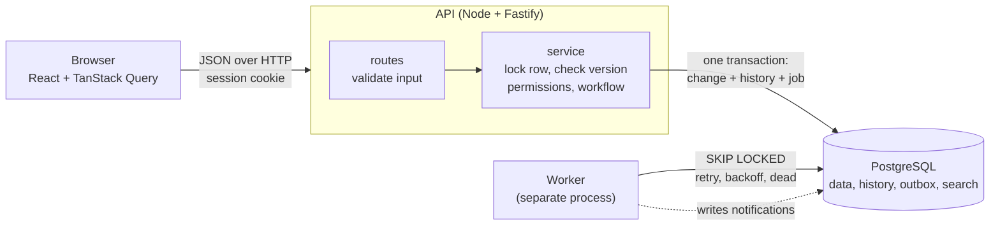
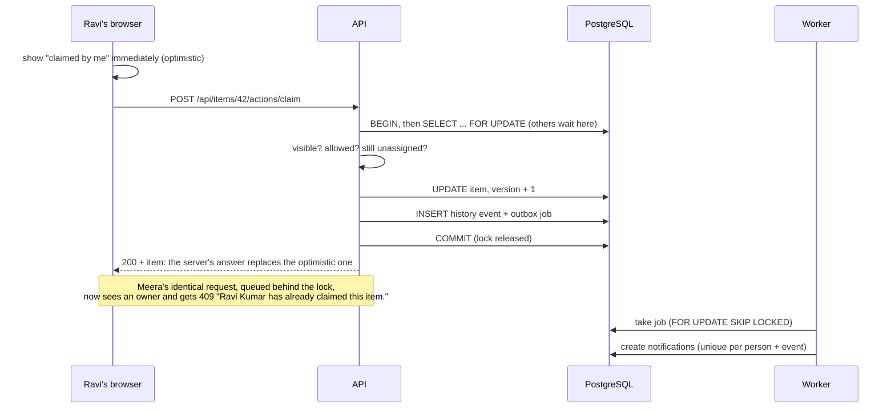

# Newtonite Work Items

An internal web application for coordinating operational work: customer issues,
incidents, payment investigations, compliance requests and tasks that need
approval. Every item has an owner, a status, a priority, a reason it exists, a next
step and a complete history. Teams, roles and a workflow decide who may do what,
and the system stays correct when many people act on the same item at once.

## Quick start

Requirements: Docker Desktop.

```bash
docker compose up --build
```

Open **<http://localhost:3000>** and pick a demo account on the login screen
(every password is `password123`). The first build takes a few minutes.

Three containers run: **db** (PostgreSQL 16), **api** (the HTTP API, which also
serves the web app) and **worker** (background jobs). On startup the database is
migrated and filled with demo data: 3 teams, 8 people with different roles, and
5,000 work items. Both steps are safe to repeat. `docker compose down -v` starts
again from an empty database.

---

## How this meets the brief

### What a user can understand about an item

| The brief asks that a user can see… | Where |
|---|---|
| what the item is and why it exists | Title, type and **Why it exists** on the item page |
| its current state and importance | Status, the **workflow track**, and priority (colour *and* word) everywhere |
| who is responsible for it | Owner on every row and on the item page |
| what has happened previously | **History and comments**: every change, who made it, when, and why |
| what requires attention next | **Next step** on each item, and the **Needs attention** dashboard |

### The critical behaviours (the brief asks for at least three; all seven are covered)

| Situation | How it is handled | Proven by |
|---|---|---|
| Simultaneous actions by multiple users | Every change locks the item's row for the length of one transaction, so concurrent requests queue for milliseconds. Two simultaneous claims: one wins, the other gets `409 ALREADY_CLAIMED` naming the winner. | `concurrency.test.ts` (9 simultaneous claims → 1 winner), e2e claim race |
| Handling stale information | Each item has a `version`. Edits and workflow actions must send the version the user saw; if it changed, `409 VERSION_CONFLICT` returns the current item. | `concurrency.test.ts`, e2e edit conflict |
| Preventing accidental duplicates | `Idempotency-Key` on create and comment, recorded in the same transaction as the work; a retry replays the original response. | `idempotency.test.ts` (5 simultaneous submits → 1 item), e2e retried create |
| Enforcing workflow rules | A state machine defined as data; payment and compliance items need a lead's approval; nobody approves their own request (four-eyes); rejecting needs a reason. | `workflow.test.ts`, e2e rejection |
| Reliable asynchronous processing | Notifications go through a transactional outbox and a separate worker: retries with backoff, dead jobs after 5 attempts, safe to run twice. | `worker.test.ts` |
| Authorization at the resource level | Permission depends on your role **in the item's team**, plus ownership and four-eyes rules, all in one function. Other teams' items return 404. | `permissions.test.ts`, `authorization.test.ts`, e2e viewer test |
| Reconciling optimistic UI with the server | Claim is shown instantly and rolled back if someone else won; a stale edit shows the other person's changes and lets the user keep theirs on top or discard. | e2e claim race and edit conflict |

### The engineering areas the brief lists

| Area | Where to look |
|---|---|
| Data modelling | `server/src/db/migrations/001_init.sql`: per-team roles on the membership, append-only history, database-enforced invariants (e.g. an item in progress must have an owner) |
| API design | REST with one endpoint per workflow action (`/actions/claim`, `/actions/approve`…), not a generic status `PATCH`; one error shape with machine-readable codes (see [API](#api)) |
| Frontend state management | Server data in TanStack Query's cache, filters in the URL, drafts in component state ([decision F](ENGINEERING_DECISIONS.md#f-frontend-server-state-in-a-query-cache-optimistic-only-where-its-safe)) |
| Authorization | `server/src/permissions.ts`: the only place permissions are decided |
| Concurrent operations | `server/src/items/service.ts`: every change goes through `mutateItem()` |
| Error handling | `server/src/errors.ts` + a central handler: typed errors, consistent JSON, no internals leaked; the UI shows each error's meaning ("Ravi Kumar has already claimed this item.") |
| Data consistency | Change + history entry + notification job commit in **one** transaction; database constraints catch application bugs |
| Search and filtering | Server-side filters and Postgres full-text search, kept in the URL so views can be shared |
| Application performance | Indexes matched to each query; cursor pagination (50 at a time); the dashboard asks for 8 rows per queue; nothing loads the whole dataset |
| Maintainability | Rules live in one place each (permissions, workflow, errors); routes contain no business logic; tests describe behaviour in plain sentences |

The reasoning and trade-offs behind all of this are in
**[ENGINEERING_DECISIONS.md](ENGINEERING_DECISIONS.md)**.

---

## Architecture



What happens when someone claims an item:



---

## Things to try

Use two browser windows side by side, one of them private, so each has its own login.

1. **Claim race.** Ravi and Meera open the same OPEN Payments item. Ravi clicks **Claim**, then Meera does. Meera's screen rolls back and says *"Ravi Kumar has already claimed this item."*
2. **Edit conflict.** Asha (lead) and Ravi (owner) both click **Edit** on the same item. Ravi changes the priority and saves; then Asha saves her description change. Asha sees *"Someone else saved first"* with Ravi's change listed, and chooses to keep her changes on top of his or discard them.
3. **Approval and four-eyes.** As Ravi, claim a **Payment** item: there is no **Resolve** button, only **Request approval**. Arjun's bell shows the request; he can **Approve** or **Reject…** (a reason is required). Asha can never approve her own requests.
4. **Permissions.** Vikram (Engineering viewer) sees no create button and no actions, and a Payments item link shows "Item not found".
5. **Scale.** **All items** browses 5,000 items 50 at a time, with filters and text search kept in the URL.

## Demo users

Every password is `password123`. Roles are per team, deliberately mixed.

| User | Email | Payments | Customer Support | Engineering |
|---|---|---|---|---|
| Asha Rao | asha@newtonite.test | lead | viewer | — |
| Arjun Mehta | arjun@newtonite.test | lead | — | lead |
| Ravi Kumar | ravi@newtonite.test | member | — | — |
| Meera Iyer | meera@newtonite.test | member | — | member |
| Priya Nair | priya@newtonite.test | viewer | member | — |
| Kabir Shah | kabir@newtonite.test | — | lead | — |
| Neha Gupta | neha@newtonite.test | — | member | member |
| Vikram Singh | vikram@newtonite.test | — | — | viewer |

| Role | Can |
|---|---|
| viewer | see the team's items |
| member | also create, comment, claim, and change items **they own** |
| lead | also change any item in the team, assign, approve or reject (never their own request), close, reopen |

---

## Tests

Tests target the behaviours that would be dangerous if wrong, not a coverage
number. Every safety mechanism was checked by deliberately removing it (the row
lock, the version check, the atomic idempotency insert, `SKIP LOCKED`, the job
savepoint, the UI's idempotency key, correct logout): each time, the matching test
failed, and it passed again once the mechanism was restored.

### API and database tests (76)

Run against a real PostgreSQL, in a separate `newtonite_test` database that is
wiped on every run; demo data is never touched.

```bash
docker compose run --rm --build api npm test
```

| File | What it proves |
|---|---|
| `concurrency.test.ts` | 9 simultaneous claims → exactly one winner; stale edits rejected and nothing overwritten; 5 simultaneous saves → one succeeds; failed requests leave no history |
| `idempotency.test.ts` | A retry returns the original response; 5 simultaneous submissions with one key → one item; a key reused for a different request is rejected; keys are per user; a failed request doesn't use up its key |
| `workflow.test.ts` | Invalid transitions (422); the approval flow; four-eyes; rejection needs a reason; members can't change others' items; assignment rules; `allowed_actions` per person |
| `worker.test.ts` | The right people are notified (never the actor); a failed action creates no job; a job run twice → one notification; retry with backoff; partial writes undone; dead after 5 attempts; parallel workers never share a job |
| `permissions.test.ts` | Every role × every action; ownership; four-eyes; no role leaks across teams |
| `authorization.test.ts` | Calling the API directly: another team's item gets the same 404 as a missing one |
| `auth.test.ts` | Login, httpOnly cookie, identical errors for wrong password and unknown email, logout revokes the session |
| `items.test.ts` | Validation; lists only show your teams; filters; search; pagination visits every item once and stays stable while data changes |
| `dashboard.test.ts` | Approval requests reach other leads, never the requester; each queue contains only what it claims to |

### Browser tests (6)

End-to-end runs in Chromium, with several people logged in at once. They run
against the running app, so start it first (`docker compose up`), then:

```bash
cd e2e
npm install
npx playwright install chromium   # first time only
npm test
```

They cover: the claim race, the edit conflict, a create request delivered twice,
rejection needing a reason, a viewer's and an outsider's view, and logging out
then in as someone else.

---

## The web interface

| Screen | What it does |
|---|---|
| **Needs attention** | Four short queues: assigned to you, waiting for your approval, unclaimed and urgent, overdue. Up to 8 items each, with the total. |
| **All items** | Filters (team, status, priority, type, assignee) and text search, all in the URL; 50 items at a time with "Load 50 more". |
| **Item** | Workflow track; why it exists and next step; your available actions; edit form; history and comments. |
| **New item** | Creates an item; the form carries an idempotency key, so a duplicate submission creates it once. |
| **Bell** | Unread notifications, refreshed every 15 seconds. |

- Only the actions the server lists in `allowed_actions` are shown, and the server re-checks every request.
- Screens refresh every 15–30 s and when the window regains focus. Correctness does not depend on this: versions catch anything stale.
- Keyboard focus is always visible, dialogs are native `<dialog>` elements, form errors appear after interaction and are announced to screen readers, priority is never shown by colour alone, and the layout works on a phone.

---

## API

Every error has one shape: `{ "error": { "code": "...", "message": "...", ... } }`.

| Method | Path | Notes |
|---|---|---|
| POST | `/api/auth/login` | `{ email, password }` → user with teams and roles; sets the session cookie |
| POST | `/api/auth/logout` | revokes the session |
| GET | `/api/auth/me` | current user with teams and roles |
| GET | `/api/dashboard` | queues `mine`, `approvals`, `unclaimed`, `overdue`, each `{ items, total }` |
| GET | `/api/items` | filters `team`, `status`, `priority`, `type` (comma-separated), `assignee` (`me`, `unassigned`, id), `q` (text), `limit`, `cursor` → `{ items, nextCursor }` |
| POST | `/api/items` | create → 201. Accepts `Idempotency-Key` |
| GET | `/api/items/:id` | item + your `allowed_actions`. 404 if missing **or** in a team you're not in |
| PATCH | `/api/items/:id` | edit `title`, `description`, `priority`, `next_step`, `due_at`. **Requires `version`** |
| POST | `/api/items/:id/actions/:action` | workflow actions (below). All except `claim` require `version` |
| POST | `/api/items/:id/comments` | `{ body }` → 201. Accepts `Idempotency-Key` |
| GET | `/api/items/:id/activity` | history, newest first; `limit`, `cursor` |
| GET | `/api/teams/:id/members` | for assignment pickers |
| GET | `/api/notifications` | latest notifications + `unreadCount` |
| POST | `/api/notifications/:id/read`, `/api/notifications/read-all` | mark read |
| GET | `/api/health` | database check + background job counts (`pending`, `dead`) |

### Workflow

```
OPEN ──claim/assign──► IN_PROGRESS ──request_approval──► AWAITING_APPROVAL
  ▲                      │   ▲   │                          │        │
  └────── unassign ──────┘   │   └──── resolve ───┐       reject   approve
                             └───────── reopen ───┼─────────┘        │
                                                  ▼                  │
                                              RESOLVED ◄─────────────┘
                                                  │
                                                close ──► CLOSED (final)
```

| Action | Who | Body |
|---|---|---|
| `claim` | member or lead | none; succeeds only if unassigned; repeating it is harmless |
| `assign` | lead | `version`, `assignee_id` (a member or lead of the team) |
| `unassign`, `request_approval`, `resolve` | the owner, or a lead | `version` |
| `approve` | a lead other than the requester | `version` |
| `reject`, `reopen` | a lead (reject: not the requester) | `version`, `reason` (required, kept in history) |
| `close` | lead | `version` |

`payment` and `compliance` items cannot be resolved directly; they must be approved.

| Status | Meaning |
|---|---|
| 400 | malformed request (`VALIDATION_ERROR`, listing the bad fields) |
| 401 | not logged in |
| 403 | you can see the item but may not do this |
| 404 | not found, or in a team you're not in |
| 409 | `VERSION_CONFLICT` (includes the `current` item) or `ALREADY_CLAIMED` (includes who) |
| 422 | breaks a rule: `INVALID_TRANSITION`, `APPROVAL_REQUIRED`, `INVALID_ASSIGNEE`, `ITEM_CLOSED`, `IDEMPOTENCY_KEY_REUSED` |

### Who gets notified

| Event | Notified |
|---|---|
| assigned / unassigned | the new / previous owner |
| approval requested | every lead of the team |
| approved / rejected | whoever asked for approval (with the reason) |
| commented | the owner and the creator |
| resolved / closed / reopened | the owner |

Nobody is notified about their own action.

---

## Project layout

```
docker-compose.yml        db + api + worker (built by server/Dockerfile, which also builds web/)
ENGINEERING_DECISIONS.md  the key decisions and their trade-offs
server/
  src/
    app.ts                assembles the API: plugins, routes, central error handler, serves the UI
    permissions.ts        every authorization rule: can() / authorize()
    errors.ts             typed errors → one JSON error shape
    idempotency.ts        Idempotency-Key handling, atomic with the request's work
    items/
      service.ts          business logic; every change goes through mutateItem()
      workflow.ts         the state machine, as data
      events.ts           history + outbox jobs, in the change's transaction
      routes.ts           HTTP only: validation and response shapes
      repository.ts       queries, cursor pagination, history
    worker/
      queue.ts            job processing: SKIP LOCKED, backoff, dead jobs
      notify.ts           turns an event into notifications (safe to repeat)
      index.ts            the worker process
    auth/ teams/ notifications/ dashboard/   smaller route groups
    db/
      migrations/         001 schema · 002 sessions · 003 OPEN means unassigned · 004 overdue index
      migrate.ts          applies each migration once, under a lock
      seed.ts             demo teams, people and 5,000 items
  test/                   76 tests against a real PostgreSQL
web/
  src/
    api.ts                the only place the UI talks to the server
    components/           ActionPanel (optimistic claim), EditForm (conflicts), Timeline,
                          WorkflowTrack, NotificationBell, PromptDialog, Toast
    pages/                Login, Dashboard, ItemList, ItemDetail, NewItem
    styles.css            the whole visual design
e2e/                      6 browser tests (Playwright)
```

## Running without Docker

With Node 22+ and PostgreSQL running (e.g. `docker compose up -d db`), in three terminals:

```bash
cd server && npm install && npm run setup && npm run dev   # API on :3000
cd server && npm run worker                                # background jobs
cd web && npm install && npm run dev                       # UI on :5173, hot reload
```

Open <http://localhost:5173>; the UI's dev server forwards `/api` to `:3000`.

---

## Assumptions

The brief leaves much open on purpose. Decisions made:

- **Every item belongs to exactly one team**, whose membership decides who can see and change it.
- **Roles are per team:** viewer, member, lead (see [Demo users](#demo-users)).
- **OPEN means nobody owns it yet.** Claiming or assigning moves an item to IN_PROGRESS.
- **Payment and compliance items need a lead's approval**, and never the requester's own (four-eyes).
- **CLOSED is final;** RESOLVED items can be reopened by a lead, with a reason.
- **Items and comments are never deleted**, so history stays complete.
- **Comments don't change an item's version**, so commenting never makes someone's edit conflict.
- **Login is deliberately simple** (seeded people, password). A real deployment would use company SSO.

## Known limitations

- **Updates appear within 15–30 seconds, not instantly** (polling). Version checks keep it correct; push updates are next on the list.
- **Search results are ordered by most recently updated**, not by relevance.
- **Lists show no total count**; counting every match is slow on large tables, so the dashboard uses targeted queues instead.
- **Conflicts are resolved by the user**, with the other person's changes shown; there is no automatic field merging.
- **No login rate limiting** and no CSRF tokens beyond `SameSite=Lax` cookies and a JSON-only API. Cookies are only marked `Secure` when `SECURE_COOKIES=true` (the demo runs on plain http).
- **No admin screens:** users, teams and roles come from seed data; dead jobs are inspected with SQL (`SELECT * FROM outbox_jobs WHERE status = 'dead'`).
- **The worker handles one job per transaction and polls every second.** Plenty for notifications at this scale; higher volume would batch jobs and use `LISTEN/NOTIFY`.
- **`/api/health` is public** and shows record counts; in production it would be internal only.
- **Notifications are in-app only.** Email or Slack would be another job type on the same queue.

## With another week

1. Push updates (Server-Sent Events) so screens change the moment someone acts.
2. SLA timers and escalation: overdue critical items notify the team lead.
3. Company SSO, and team membership synced from the directory.
4. An admin view for dead jobs, with retry.
5. Email and Slack notifications through the existing outbox.
6. Metrics and tracing: request latency, lock waits, job age.
